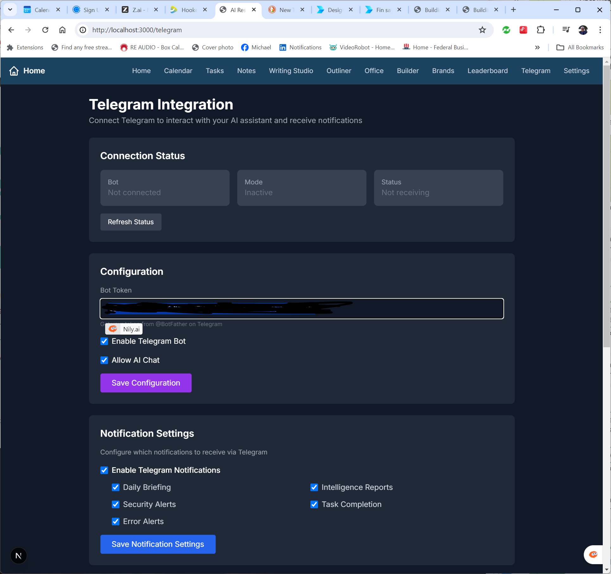

# Agent Dashboard

**Your own private AI agent with a browser, a Linux terminal, and a phone in your pocket — no subscriptions, no data leaks, no vendor lock-in.**

Agent Dashboard combines [OpenMuse](https://github.com/CopilotKit/OpenMuse) (an open-source personal agent with browser + computer use) with **gpt-oss-120b** served by [llama.cpp](https://github.com/ggml-org/llama.cpp) by default, controlled from the web, from Telegram, or from an Android app. It can browse the web for you, run commands in its own isolated Linux computer, and report back — all driven by a local model.

**Any model, your choice.** The agent speaks an OpenAI-compatible protocol, so it runs on llama.cpp (default — best performance), Ollama, LM Studio, vLLM, or any OpenAI-compatible server — and it can use Anthropic or Google models natively. One line in `.env` switches backends. See [Chapter 23](book/Chapter-23-Where-The-Idea-Came-From.md).

Includes Michael C. Barnes' book **Building Your AI Dashboard** (384 pages) **free**, plus a new chapter on **Freebuff**.

## 📖 Free Book

**[Building Your AI Dashboard: The Complete Guide](book/Building_Your_AI_Dashboard.pdf)**  
*From Zero to Enterprise-Grade AI — On Your Own Personal Computer*

New in this repo: **[Chapter 22: Freebuff — Your Free AI Coding Agent](book/Chapter-22-Freebuff.md)** and **[Chapter 23: Where the Idea Came From](book/Chapter-23-Where-The-Idea-Came-From.md)** — on Freebuff, on OpenMuse attribution, and on swapping any model backend.

## ✨ What You Get

- 🤖 **Personal agent** — OpenMuse runtime (Hono API + CopilotKit) driven by your own model
- ⚡ **llama.cpp by default** — best local performance for gpt-oss; swap in Ollama, LM Studio, vLLM, or a cloud provider with one line
- 🌐 **Browser worker** — a persistent Chromium the agent drives to research and summarize the web
- 🐧 **Its own Linux computer** — a Docker container with a terminal, isolated from your machine by design
- 📱 **Telegram control** — message your agent from your phone; approvals arrive as inline buttons
- 📲 **Android app** — Expo client that talks straight to your API
- 📚 **The book** — the full 384-page guide, now with the Freebuff chapter
- 🛡️ **Local-first** — your conversations and your data stay on your machine

## 🚀 Quick Start

```bash
git clone https://github.com/<your-user>/Agent-Dashboard.git
cd Agent-Dashboard

# 1. Model backend — llama.cpp (default, best performance)
#    Download the GGUF and start the server (see docs/Model-Setup.md):
llama-server -hf ggml-org/gpt-oss-120b-GGUF --jinja --port 8080 --host 127.0.0.1
#    ...or use Ollama if you prefer easy model management:
#    ollama pull gpt-oss:120b

# 2. Agent runtime (OpenMuse)
cd OpenMuse
pnpm install --frozen-lockfile
cp .env.example .env
#    set: MODEL=openai/gpt-oss:120b
#         OPENAI_BASE_URL=http://127.0.0.1:8080/v1   # llama.cpp
#         (or http://127.0.0.1:11434/v1 for Ollama)
pnpm dev            # API on :8787
pnpm dev:web        # web UI on :8081 (second terminal)

# 3. Telegram bridge
cd ../telegram-bridge
npm install
node index.js
```

Open http://localhost:8081 — or send a Telegram message from your phone.

## 📖 Documentation

- **[User Guide](docs/User-Guide.md)** — walkthrough of the Agent Dashboard UI
- **[Quick Start](docs/Quick-Start.md)** — clone → env → run
- **[Model Setup](docs/Model-Setup.md)** — llama.cpp (default) + Ollama with gpt-oss-120b, and how to use any other OpenAI-compatible server
- **[Linux Computer](docs/Linux-Computer.md)** — Docker computer, boundaries, receipts
- **[Telegram](docs/Telegram.md)** — control your agent from your phone
- **[Android App](docs/Android-App.md)** — building and running the mobile client
- **[Freebuff](docs/Freebuff.md)** — the free AI coding agent + GitHub skills
- **[Book (PDF)](book/Building_Your_AI_Dashboard.pdf)** — full 384-page guide

## 🏗️ Architecture

```
                     ┌─────────────────────────────────────────────┐
 Phone (Telegram) ──►│ Telegram bridge (Agent-Dashboard)           │
                     └───────────────┬─────────────────────────────┘
                                     │
 Android app (Expo) ──► OpenMuse API (Hono + CopilotKit runtime, :8787)
 Web UI (:8081)         │  AGENT_BACKEND=model
                       │
                       ├── OPENAI_BASE_URL ──► Ollama (/v1/responses)
                       │                        └── gpt-oss:120b
                       ├── Browser worker (Playwright Chromium, :8790)
                       └── Docker Linux computer (openmuse-computer, isolated /workspace)
```

### The pieces

| Piece | What it does | Where |
|---|---|---|
| **OpenMuse API** | Hono server + CopilotKit runtime, agent loop | `OpenMuse/apps/server` (port 8787) |
| **Web UI** | Chat, Files, Terminal, Computer panels (Expo web) | `OpenMuse/apps/mobile` (port 8081) |
| **Ollama** | Serves gpt-oss-120b via `/v1/responses` | `127.0.0.1:11434` |
| **Browser worker** | Persistent Playwright Chromium the agent uses | port 8790 |
| **Docker computer** | Isolated Linux box with terminal + /workspace volume | `apps/computer` |
| **Telegram bridge** | grammy long-poll ↔ OpenMuse conversation endpoint | `telegram-bridge/` |

### Design boundaries (the agent's computer is sandboxed by design)

- Nonroot container, **no host-directory mounts, no credentials**
- Named `/workspace` volume keeps files across restarts
- **Networking disabled** inside the terminal — web access goes through the browser worker
- 30-second command limit; output and exit codes saved as receipts

## 🛠️ Technologies

- **OpenMuse** (CopilotKit) — the source of the agent-with-a-computer idea and this project's runtime: agent API, UI, mobile app, computer image
- **llama.cpp** — default model server (best local performance for gpt-oss-120b, MXFP4); Ollama also supported
- **Node 24 LTS + pnpm 11.19.0** — build toolchain
- **Docker** — the agent's Linux computer
- **grammy** — Telegram bridge
- **Expo / React Native** — Android client

## 🎬 Screenshots

**Chat with your agent (web)** — see the OpenMuse repo for UI screenshots; your build renders the same panels: Chat, Files, Terminal, Browser.

**Telegram on your phone**  


## License

- **Code**: MIT License — use freely for any purpose
- **Book**: CC BY-SA 4.0 — share and adapt with attribution

---

Star ⭐ this repo if you believe in local-first AI that saves money and protects your data.

**Built on [OpenMuse](https://github.com/CopilotKit/OpenMuse) (CopilotKit) — which originated the agent computer, receipts, and durable-work ideas this project runs on — and the PersonalAI Dashboard book by Michael C. Barnes (@norhtecmbarnes).**